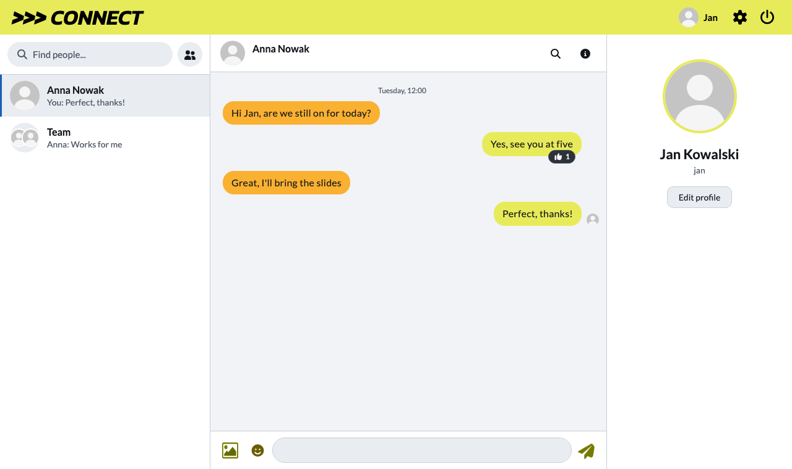

# >>> *CONNECT* messenger

A real-time chat: talk one-to-one or in groups, send photos, react to messages with emoji, edit or delete them, and see who is online, who is typing and who has read what. It comes with a dark and a light theme, several languages, desktop notifications and profile pictures. This is the web app (React); the server lives in [connect-messenger-java](https://github.com/Filip1159/connect-messenger-java).

## Screenshots

<p align="center">
  
  
</p>
<p align="center">
  
  
</p>
<p align="center">
  
</p>

```sh
npm install        # install dependencies
```

```sh
npm run dev        # start the app on http://localhost:3000
```

```sh
npm test           # run the tests
```

```sh
npm run build      # production build
```
